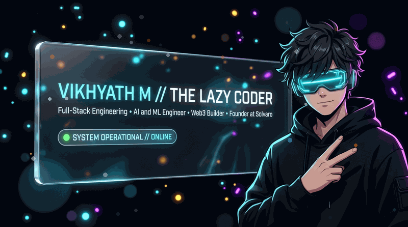
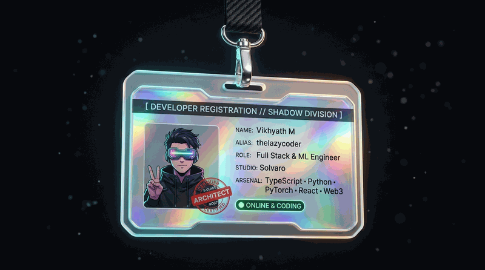
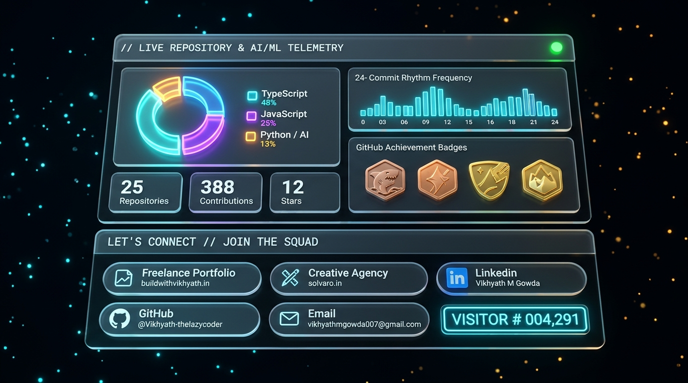
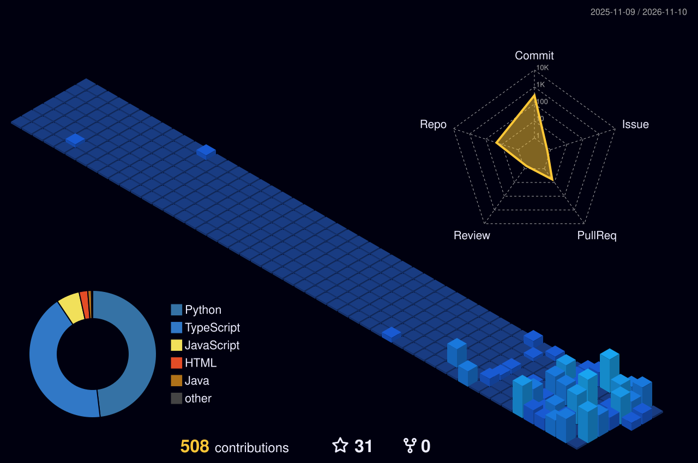

<!-- 🎬 3D GLASSMORPHIC HERO BANNER -->

  

<!-- 🪪 3D HOLOGRAPHIC SWINGING LANYARD ID BADGE -->

  

<!-- 📊 3D TELEMETRY & CONNECT HUD -->

  

## 🍥 S-Rank Missions & Verified Builds

*All project statistics, languages, and star counts are verified live from `@Vikhyath-thelazycoder`.*

<table>
<tr><th>Mission</th><th>What it is</th><th>Jutsu / Tech</th><th align="center">⭐ Stars</th></tr>
<tr><td><a href="https://solvaro.in"><b>Solvaro</b></a></td><td>Flagship creative engineering agency — high-scale web applications, AI integrations &amp; custom software</td><td><code>Next.js</code> <code>TypeScript</code> <code>Cloud</code></td><td align="center">🚀 <b>Agency</b></td></tr>
<tr><td><a href="http://buildwithvikhyath.in"><b>Portfolio</b></a></td><td>Official personal portfolio and freelance client portal</td><td><code>React</code> <code>Tailwind</code> <code>GSAP</code></td><td align="center">🌐 <b>Live</b></td></tr>
<tr><td><a href="https://github.com/Vikhyath-thelazycoder/AgyLite"><b>AgyLite</b></a></td><td>Lightweight agentic execution runtime and autonomous coding tool harness</td><td><code>Python</code> <code>Shell</code> <code>Agents</code></td><td align="center"><b>2</b></td></tr>
<tr><td><a href="https://github.com/Vikhyath-thelazycoder/smartcrowd-ai"><b>smartcrowd-ai</b></a></td><td>Edge computer vision model for real-time crowd density estimation &amp; AI/ML telemetry</td><td><code>Python</code> <code>PyTorch</code> <code>AI/ML</code></td><td align="center"><b>1</b></td></tr>
<tr><td><a href="https://github.com/Vikhyath-thelazycoder/blockchain-and-web3-property-registor"><b>blockchain-property-registor</b></a></td><td>Decentralized immutable real estate title registry on Ethereum blockchain</td><td><code>Solidity</code> <code>Hardhat</code> <code>Ethers.js</code></td><td align="center"><b>1</b></td></tr>
<tr><td><a href="https://github.com/Vikhyath-thelazycoder/sign-language-with-ar-glasses"><b>sign-language-ar</b></a></td><td>Assistive real-time sign language gesture recognition pipeline with AR integration</td><td><code>Python</code> <code>AI/ML</code> <code>AR</code></td><td align="center"><b>1</b></td></tr>
<tr><td><a href="https://github.com/Vikhyath-thelazycoder/auricvista-ai-chatbot"><b>auricvista-ai-chatbot</b></a></td><td>Conversational AI chatbot with context streaming and dynamic agent responses</td><td><code>JavaScript</code> <code>AI</code></td><td align="center"><b>1</b></td></tr>
<tr><td><a href="https://github.com/Vikhyath-thelazycoder/artifact"><b>artifact (ARTIFEX)</b></a></td><td>Techvidya 10-minute design competition with Gemini AI automated judging &amp; leaderboard</td><td><code>TypeScript</code> <code>Next.js</code> <code>Gemini</code></td><td align="center">🎨 <b>Active</b></td></tr>
<tr><td><a href="https://github.com/Vikhyath-thelazycoder/crypto-hunt"><b>crypto-hunt</b></a></td><td>Interactive blockchain puzzle platform &amp; cryptographic algorithmic challenge solver</td><td><code>TypeScript</code> <code>Python</code> <code>Web3</code></td><td align="center">⚡ <b>Live</b></td></tr>
<tr><td><a href="https://github.com/Vikhyath-thelazycoder/HeartWise"><b>HeartWise</b></a></td><td>Predictive machine learning clinical diagnostics platform with risk probability estimation</td><td><code>Python</code> <code>AI/ML</code> <code>FastAPI</code></td><td align="center">🩺 <b>Trained</b></td></tr>
</table>

<a href="https://github.com/Vikhyath-thelazycoder?tab=repositories"><b>→ See all 25 repositories</b></a>

  

### 🌃 My contribution village

*Every commit raises another building — rebuilt automatically every day.*

  

<!-- 💌 JOIN THE SQUAD -->
### ⚡ Let's Connect &amp; Collaborate

 

  

  

**Work smart, automate everything, keep shipping.** 🍥

